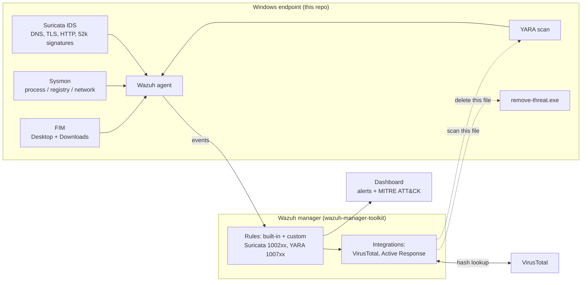

# Wazuh Endpoint Toolkit

-3595F7)

Windows **endpoint-side** deployment kits for a Wazuh SIEM: one folder per
capability, each with its own scripts, README and integration guide. Built,
debugged and validated end-to-end on live production Wazuh-monitored Windows
endpoints, then rolled out with the step-by-step guides in [`guides/`](guides).

Everything that runs on the **Wazuh manager** (custom rules, integrations,
verification scripts) lives in the companion repo:
**[wazuh-manager-toolkit](https://github.com/TanZero7/wazuh-manager-toolkit)**.

## Capabilities

| Folder | What it adds | Manager side |
|---|---|---|
| [local-admin-setup](local-admin-setup) | Pre-install hardening: one local `admin`, everyone else demoted, built-in Administrator disabled | none |
| [fim](fim) | Realtime File Integrity Monitoring on Desktop + Downloads (all profiles), no-event-loss agent tuning | built-in rules (verify only) |
| [sysmon](sysmon) | Sysmon + SwiftOnSecurity config → ~150 built-in Wazuh detections mapped to MITRE ATT&CK | built-in rules (verify only) |
| [yara](yara) | Content-based malware scan of every file FIM sees change (rules 100700/100701) | custom rules + AR block |
| [suricata](suricata) | Network IDS on the endpoint: DNS, TLS SNI, HTTP visibility + ~52k ET Open signatures | custom rules (required) |
| [virustotal-active-response](virustotal-active-response) | Auto-delete a file once VirusTotal flags it malicious | integration + AR + rules |
| [endpoint-control](endpoint-control) | Operator tools: pause/resume all monitoring, exclude a folder from every capability | none |

## How to deploy

**Always: manager side first → endpoint side → verify.**

1. **Manager**: [wazuh-manager-toolkit → guides/MANAGER-SETUP-GUIDE.md](https://github.com/TanZero7/wazuh-manager-toolkit/blob/main/guides/MANAGER-SETUP-GUIDE.md).
2. **[local-admin-setup](local-admin-setup)**: once per PC.
3. Install and enroll the **Wazuh agent** (version no newer than the manager).
4. **[guides/ENDPOINT-SETUP-GUIDE.md](guides/ENDPOINT-SETUP-GUIDE.md)**:
   FIM → Suricata → VirusTotal Active Response, then their verification.
5. **[guides/SYSMON-YARA-SETUP-GUIDE.md](guides/SYSMON-YARA-SETUP-GUIDE.md)**:
   Sysmon and YARA, then their verification.

Only need one capability (say, FIM)? Open its folder: the README and
`INTEGRATION-GUIDE.md` start with a link to its manager side, then cover the
endpoint install and the verification for that capability alone.

FIM comes first on the endpoint: YARA and VirusTotal are both triggered by FIM
events. Every verify script prints `[PASS]`/`[FAIL]` per check. **If something
shows `[FAIL]` right after installing, wait 5–10 minutes and run it again**:
several checks read status files the agent only rewrites a few minutes after a
restart.

## Engineering notes

- **No dropped events.** The Wazuh agent's anti-flooding buffer silently drops
  anything over 500 events/sec. In production this lost 1,250 Suricata DNS/TLS
  events on a single endpoint. `fim/scripts/set-no-event-loss.ps1` disables it,
  and FIM's `max_eps` is raised to 1000 so mass file operations don't backlog.
- **Idempotent, merge-don't-append config edits.** Scripts merge into the agent's
  existing `ossec.conf` blocks instead of appending new ones (an early version
  created duplicate `<syscheck>` blocks; see [CHANGELOG.md](CHANGELOG.md)).
- **Verify everything.** Each capability ships a read-only verify script, and the
  manager-side installers validate rules with `wazuh-logtest` *before* restarting.
- **Suricata on Windows** runs as a SYSTEM scheduled task with a watchdog,
  because its native `--service-install` service doesn't start reliably.

See [CHANGELOG.md](CHANGELOG.md) for the bugs found and fixed during rollout,
including a YARA manager rule that could never fire and a false-positive path in
the active-response scanner.

## Requirements

- Windows 10/11 endpoint, PowerShell 5.1+, Administrator rights
- Wazuh agent enrolled (4.x; tested with 4.14)
- Internet access during install (Sysmon, YARA rule pack, Suricata prerequisites)
- Npcap in WinPcap-compatible mode (Suricata only, manual install)

## License

See [LICENSE](LICENSE).
