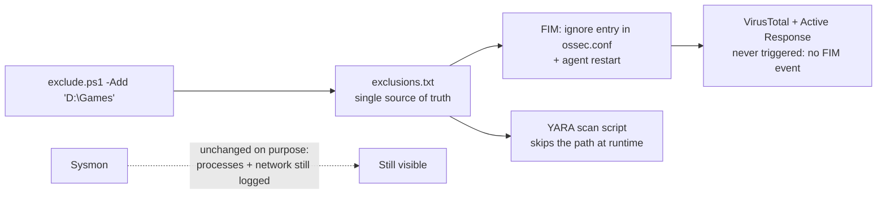

# Endpoint Control: Operator Tools

> **Order:** no manager side. Use these after the other capabilities are installed (each of those: manager first → endpoint → verify).
> Confirm state with `wazuh-control.ps1 -Status`; expected output and PASS/FAIL table in [INTEGRATION-GUIDE.md § 4](INTEGRATION-GUIDE.md#4-verification).

Two operator utilities for a Wazuh-monitored Windows endpoint. Unlike the other
folders in this repo (which *add* detection), these *control* what the endpoint's
Wazuh stack does — for the times you need a folder left alone, or the whole
stack paused.

| Tool | What it does |
|---|---|
| `wazuh-control.ps1` | **Pause / resume** everything Wazuh on this PC (agent + Suricata capture), with a Resume that restores it exactly. One switch, for heavy work / gaming / privacy windows. |
| `exclude.ps1` | Mark a **folder off-limits** to every capability — FIM, VirusTotal (and its Active Response) and YARA all skip it (Sysmon's include-only config already never logs ordinary files there). Nothing checks, scans, hashes, lists, or touches it. |

## What are these tools for?

Monitoring sometimes has to step aside: a machine doing heavy work where the
agent's CPU or disk use matters, a folder full of large files that generates
endless FIM noise, or a game/build folder full of executables that keeps
triggering scans. Doing that by hand means editing `ossec.conf`, stopping
services and remembering to undo it all, which is error-prone and easy to forget.

These two scripts make it **one command, fully reversible, and auditable**:

- **`wazuh-control.ps1`** pauses or resumes *everything* this toolkit installed
  on the PC, and leaves a marker file so it's obvious the machine is paused.
- **`exclude.ps1`** keeps one list of excluded folders and applies it to every
  capability at once.

### How an exclusion propagates



### Why a SOC cares

- **Exclusions are a classic attacker hiding place**, so this design keeps them
  safe: *file* monitoring stops for the folder, but **process execution and
  network activity from it are still recorded** by Sysmon and Suricata. A folder
  can't become a blind spot for running code.
- **A pause is visible, not silent:** the manager shows the agent as
  disconnected and the marker file records when the pause started.
  *Related ATT&CK: T1562.001 Impair Defenses: Disable or Modify Tools*. This is
  the legitimate version of what an attacker would try to do, so it's worth
  alerting on unexpected agent disconnects.

---

## Start here

| If you want to... | Read |
|---|---|
| **Use / deploy these** | **[INTEGRATION-GUIDE.md](INTEGRATION-GUIDE.md)** |

## Folder layout
```
README.md
INTEGRATION-GUIDE.md
wazuh-control.ps1     pause / resume / status
exclude.ps1           add / remove / list / apply folder exclusions
```

## Quick use (elevated PowerShell)
```powershell
# Pause everything, do your work, then resume
powershell -ExecutionPolicy Bypass -File wazuh-control.ps1 -Pause
powershell -ExecutionPolicy Bypass -File wazuh-control.ps1 -Resume
powershell -ExecutionPolicy Bypass -File wazuh-control.ps1 -Status

# Leave a folder completely alone
powershell -ExecutionPolicy Bypass -File exclude.ps1 -Add "D:\Games\CS2"
powershell -ExecutionPolicy Bypass -File exclude.ps1 -List
powershell -ExecutionPolicy Bypass -File exclude.ps1 -Remove "D:\Games\CS2"
```

## Two honest notes
- **Sysmon can't be *stopped* during a pause** — it runs tamper-protected (Access
  Denied even to admin; only `Sysmon64.exe -u` removes it). It's left running, but
  with the Wazuh agent stopped **nothing it logs is collected or sent**, so the PC
  is effectively unmonitored and its footprint is negligible (~0.6% CPU, no network).
- **Exclusions stop *monitoring*.** FIM, YARA and alert-only VirusTotal never delete
  anything; the optional VirusTotal Active Response does, but it is triggered by FIM,
  so an excluded folder is never scanned or touched. **Process execution and network activity
  from an excluded folder stay visible on purpose** — a folder that could run code
  invisibly would be a security hole. Ask if you want those excluded too.

Both tools were built and validated on a live production Wazuh-monitored workstation.
