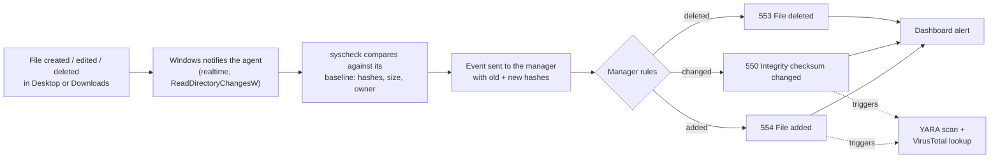

# FIM: File Integrity Monitoring (Desktop + Downloads)

> **Order:** [manager side](https://github.com/TanZero7/wazuh-manager-toolkit/tree/main/fim) **first** → then this endpoint folder → then verify ([INTEGRATION-GUIDE.md § 3](INTEGRATION-GUIDE.md)).
> Every check prints `[PASS]`/`[FAIL]`; if something shows `[FAIL]`, wait **5–10 minutes after installation** and run it again before troubleshooting.

Adds a standardized File Integrity Monitoring scope — Desktop and Downloads,
every user profile on the machine — to a Wazuh agent, realtime, with new-file
alerting on. This is the trigger event the other capabilities in this toolkit
(VirusTotal and YARA) key off.

## What is FIM?

**File Integrity Monitoring (FIM)** watches a set of folders and records a
fingerprint of every file in them: its SHA-256/SHA-1/MD5 hashes, size, owner,
permissions and timestamps. When a file is **added, changed or deleted**, the
fingerprint no longer matches and FIM raises an event saying exactly what
changed, including the old and new hashes.

In Wazuh, FIM is the agent's built-in **syscheck** module. This kit points it at
the two places users (and attackers) most often drop files, **Desktop and
Downloads, for every user profile**, and switches it to **realtime**, so changes
are reported within a second or two instead of on the default 12-hour scan.

### How it works here



1. **Baseline:** on first start the agent hashes every file in scope and stores
   the result locally.
2. **Watch:** Windows tells the agent the moment something in those folders changes.
3. **Compare:** the agent re-fingerprints that one file and diffs it against the baseline.
4. **Report:** the difference goes to the manager, whose built-in rules turn it
   into an alert. Rules 550/554 also act as the **trigger** for the
   [YARA](../yara) scan and the [VirusTotal](../virustotal-active-response) lookup.

### What you see in Wazuh

| Rule | Level | Meaning | Key fields |
|---|---|---|---|
| **554** | 5 | File added to the system | `syscheck.path`, `syscheck.sha256_after` |
| **550** | 7 | Integrity checksum changed | `syscheck.sha256_before` → `syscheck.sha256_after`, `syscheck.changed_attributes` |
| **553** | 7 | File deleted | `syscheck.path` |

Dashboard search: `rule.groups:syscheck`.

### Why a SOC cares

- **Malware delivery:** a payload saved from a browser or email lands in
  Downloads, raising a 554 with its hash, which can be checked against threat intel
  (that's exactly what the VirusTotal kit does automatically). *ATT&CK: T1105 Ingress Tool Transfer.*
- **Tampering:** a document or script silently modified shows as 550 with
  before/after hashes. *ATT&CK: T1565.001 Stored Data Manipulation.*
- **Clean-up / anti-forensics:** files deleted after use show as 553.
  *ATT&CK: T1070.004 File Deletion.*
- **Forensic timeline:** every alert carries a timestamp and hash, so you can
  reconstruct exactly which files appeared when.

---

## Start here

| If you want to... | Read |
|---|---|
| **Deploy this from scratch** | **[INTEGRATION-GUIDE.md](INTEGRATION-GUIDE.md)** |

## Folder layout

```
README.md
INTEGRATION-GUIDE.md      full deployment + troubleshooting guide
Run-Setup.cmd             runs the three scripts below in order
Run-Verify.cmd            health check, changes nothing
scripts/
  install-fim-scope.ps1   merges Desktop + Downloads into the agent's existing <syscheck>
  set-no-event-loss.ps1   disables the agent anti-flooding buffer (no dropped events)
  verify.ps1              [PASS]/[FAIL] checks
```

Nothing to *install* on the manager: Wazuh's built-in FIM rules (550
modified, 553 deleted, 554 added) handle alerting out of the box. The
`fim/check-fim-rules.sh` script in [wazuh-manager-toolkit](https://github.com/TanZero7/wazuh-manager-toolkit) only **verifies** that.

## Install

Follow **[../guides/ENDPOINT-SETUP-GUIDE.md § 1](../guides/ENDPOINT-SETUP-GUIDE.md#1-fim-file-integrity-monitoring)**
(elevated Command Prompt, one script at a time), or run `Run-Setup.cmd` as administrator.

## Check it's working

`scripts\verify.ps1` (or `Run-Verify.cmd`): every line `[PASS]`, ending in "All checks passed." Then create or edit a file in Desktop or
Downloads and watch the dashboard (`rule.groups:syscheck`). Expect an
alert within a couple of seconds.

## Known limitations

- Scope is intentionally narrow (Desktop + Downloads) to keep noise and
  scan time manageable — this is where a user or an attacker is most likely
  to drop a file, not a full-disk watch.
- Uses `realtime`, not `whodata` — see the header comment in
  `install-fim-scope.ps1` for why, and pair with [Sysmon](../sysmon) if you need
  "who made the change" attribution.
