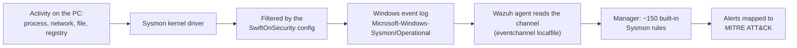

# Sysmon: Windows Process Telemetry

> **Order:** [manager side](https://github.com/TanZero7/wazuh-manager-toolkit/tree/main/sysmon) **first** → then this endpoint folder → then verify ([INTEGRATION-GUIDE.md § 4](INTEGRATION-GUIDE.md)).
> Every check prints `[PASS]`/`[FAIL]`; if something shows `[FAIL]`, wait **5–10 minutes after installation** and run it again before troubleshooting.

Installs Microsoft Sysinternals Sysmon on a Windows endpoint with the
[SwiftOnSecurity](https://github.com/SwiftOnSecurity/sysmon-config) baseline
configuration, and wires the local Wazuh agent to read its event log. Wazuh's
**built-in** Sysmon ruleset does the rest, with no custom server-side rules needed.

Gives you:

1. **Rich process telemetry**: every process create/terminate with full
   command line and parent chain, network connections, file creates, registry
   Set-Value, image/driver loads, named-pipe creates, WMI event
   filters/consumers, process-access (credential-dumping patterns), raw disk
   access.
2. **~150 built-in Wazuh detections** across those event types, already
   mapped to MITRE ATT&CK (T1059 command interpreters, T1003 credential
   dumping, T1055 process injection, T1547 persistence, T1218 LOLBins, and
   more).

## What is Sysmon?

**Sysmon (System Monitor)** is a free Microsoft Sysinternals tool: a Windows
service plus a kernel driver that records detailed security events to its own
event log (`Microsoft-Windows-Sysmon/Operational`). Standard Windows logging
tells you *that* a program ran; Sysmon tells you **what ran, with its full
command line, which process launched it, the file's hash, what it connected to,
what it wrote and which registry keys it touched**.

What gets logged is controlled by an XML config. This kit uses the widely used
open-source [SwiftOnSecurity](https://github.com/SwiftOnSecurity/sysmon-config)
config, which keeps the security-relevant events and filters out routine noise.

### How it works here



### Sysmon events you'll use most

| Event ID | What it records | Example of what it catches |
|---|---|---|
| **1** | Process created (full command line, parent, hashes) | `powershell -enc …` launched by Word |
| **3** | Network connection | an unknown binary calling out to an internet IP |
| **7** | Image (DLL) loaded | DLL side-loading |
| **8** | CreateRemoteThread | process injection |
| **10** | Process accessed another process | credential dumping from `lsass.exe` |
| **11** | File created | executable dropped in a startup folder |
| **12 / 13 / 14** | Registry key/value created, set, renamed | Run-key persistence |
| **22** | DNS query | lookups for suspicious domains |

### What you see in Wazuh

Wazuh ships rules for these events out of the box; alerts carry the
`sysmon_eventN` group and MITRE technique IDs. Useful searches:
`rule.groups:sysmon_event1` (process creation), `rule.groups:sysmon_event3`
(network), `rule.groups:sysmon_event13` (registry), `rule.mitre.id:T1059*`
(command interpreters).

### Why a SOC cares

Most real intrusions are visible as **process behaviour**, not files: a script
interpreter spawned by an Office document, a living-off-the-land binary
(`rundll32`, `mshta`, `certutil`) doing something unusual, a process opening
`lsass.exe`. Sysmon is the standard source for that telemetry. In this
deployment it covered **40+ ATT&CK techniques on its own**, including *T1059
Command and Scripting Interpreter, T1003 OS Credential Dumping, T1055 Process
Injection, T1547 Boot or Logon Autostart, T1218 System Binary Proxy Execution*.

---

## Start here

| If you want to... | Read |
|---|---|
| **Deploy step by step** | **[../guides/SYSMON-YARA-SETUP-GUIDE.md § 1](../guides/SYSMON-YARA-SETUP-GUIDE.md#1-sysmon-endpoint)** |
| Full reference, verification, troubleshooting | [INTEGRATION-GUIDE.md](INTEGRATION-GUIDE.md) |

## Folder layout

```
README.md
INTEGRATION-GUIDE.md          full deployment + troubleshooting guide
Run-Setup.cmd                 runs the three scripts below in order
Run-Verify.cmd                health check, changes nothing
scripts/
  install-sysmon.ps1          downloads Sysmon + SwiftOnSecurity config, installs the service
  wire-wazuh-agent.ps1        adds the Sysmon event channel to the agent
  verify.ps1                  [PASS]/[FAIL] checks
```

Nothing to install on the manager: Wazuh's built-in Sysmon ruleset covers it.
`sysmon/check-sysmon-rules.sh` in
[wazuh-manager-toolkit](https://github.com/TanZero7/wazuh-manager-toolkit)
verifies that ruleset is present.

## Install (elevated Command Prompt)

```bat
cd sysmon
powershell -ExecutionPolicy Bypass -File .\scripts\install-sysmon.ps1
powershell -ExecutionPolicy Bypass -File .\scripts\wire-wazuh-agent.ps1
```

Or right-click `Run-Setup.cmd` → *Run as administrator*.

## Check it's working

Run `scripts\verify.ps1` (or `Run-Verify.cmd`): every line `[PASS]`, ending in "All checks passed." Then in the Wazuh dashboard:
**Threat Hunting** → index `wazuh-alerts-*` → `rule.groups:sysmon_event1`
(or `_event3`, `_event11`, etc. for other event types).

## Deploying to another Windows machine

Nothing is hardcoded to one host. Copy this folder, run the scripts, done.
Prerequisite: a Wazuh agent already enrolled.

## Known limitations

- SwiftOnSecurity's config is a broad, moderate-noise baseline, so expect some
  tuning for your environment (exclude your own deployment/RMM tooling if it
  triggers `sysmon_event1` noise).
- Sysmon sees what runs on **this** endpoint; it is not a network sensor
  (pair with [Suricata](../suricata) for network visibility).
- Event ID 10 (ProcessAccess) is intentionally scoped down in the stock
  config to avoid extreme volume. This is standard practice, not a bug.
