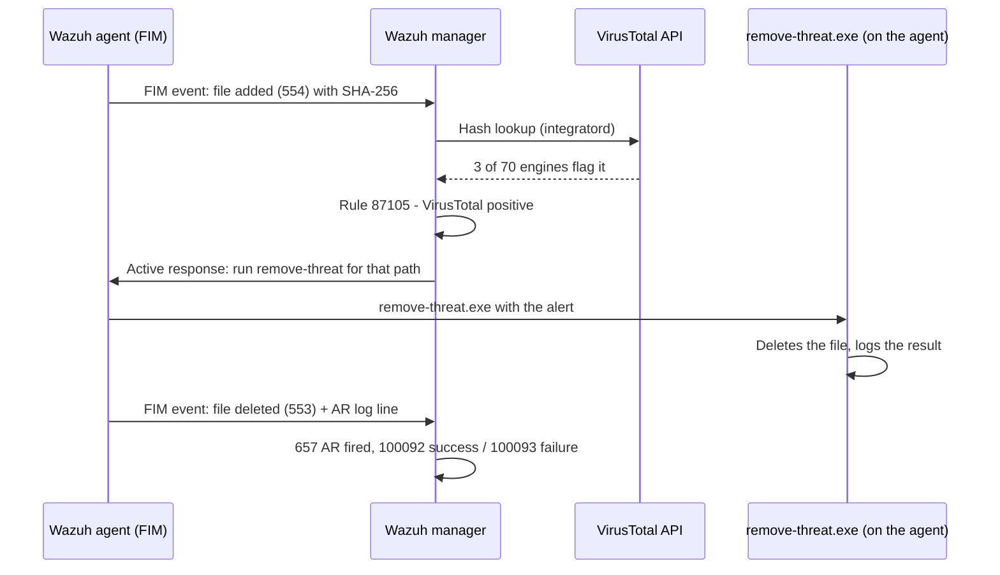

# VirusTotal Active Response (endpoint half)

> **Order:** [manager side](https://github.com/TanZero7/wazuh-manager-toolkit/tree/main/virustotal) **first** → then this endpoint folder → then verify ([INTEGRATION-GUIDE.md § 3](INTEGRATION-GUIDE.md)).
> Every check prints `[PASS]`/`[FAIL]`; if something shows `[FAIL]`, wait **5–10 minutes after installation** and run it again before troubleshooting.

Wazuh's VirusTotal integration looks up the hash of every file FIM sees added or
changed. On its own it only **alerts** (rule 87105). This folder adds the
endpoint half of **Active Response**: when VirusTotal reports a file as malicious,
the manager tells the agent to run `remove-threat.exe`, which **deletes the file
automatically**, with no human approval step.

Confirmed working end-to-end on live endpoints:

```
554 file added  →  87105 VirusTotal positive  →  657 Active Response fired  →  553 file deleted
```

> ⚠️ Active Response deletes files automatically and irreversibly. Keeping
> VirusTotal alert-only is a perfectly reasonable choice; only wire this up
> fleet-wide if automatic deletion is what you want.

## What is VirusTotal, and what is Active Response?

**VirusTotal** is a Google-owned online service that checks files against
**~70 antivirus engines** and its own reputation data. Wazuh has a built-in
integration that sends VirusTotal the **SHA-256 hash** of each file FIM sees
added or changed (only the hash, never the file itself) and raises an alert
if any engines flag it.

**Active Response** is Wazuh's mechanism for running a program on an agent
automatically when a specific alert fires. This folder installs
`remove-threat.exe`, the program the manager runs when VirusTotal reports a
file as malicious, so the file is **deleted within seconds, with no human in the
loop**.

### How it works here



### What you see in Wazuh

| Rule | Level | Meaning |
|---|---|---|
| **87103 / 87104** | 3 | VirusTotal: no record / no positives (file looks clean) |
| **87105** | 12 | VirusTotal: positives found (engine count + permalink) |
| **657** | 3 | Active response triggered (`remove-threat.exe`) |
| **553** | 7 | FIM: the flagged file was deleted |
| **100092 / 100093** | 12 | Threat removed successfully / removal failed, with the file path |

Dashboard search: `rule.groups:virustotal`.

### Why a SOC cares

- **Instant reputation check** on every new file in Downloads/Desktop, using
  ~70 engines instead of one local antivirus.
- **Closes the loop automatically:** alert-only VirusTotal still needs an
  analyst to remove the file; Active Response contains it in seconds, which
  matters out of hours. *ATT&CK: T1204.002 User Execution: Malicious File.*
- **Privacy-safe:** only hashes leave the network, not file contents.
- **Trade-off to decide consciously:** automatic deletion can remove a false
  positive. That's why it's optional and the manager logs every removal (100092/100093).

---

## Folder layout

```
README.md
scripts/
  install-active-response.ps1     copies bin\remove-threat.exe into the agent's active-response\bin
bin/
  PUT-remove-threat.exe-HERE.txt  how to build remove-threat.exe (not committed to git)
```

## Prerequisites

1. **Manager side first**: [wazuh-manager-toolkit → virustotal](https://github.com/TanZero7/wazuh-manager-toolkit/tree/main/virustotal)
   (VirusTotal integration + the Active Response block).
2. **FIM** installed on the endpoint ([../fim](../fim)), because VirusTotal is triggered by FIM events.
3. **`remove-threat.exe`** placed in `bin\`. See
   [`bin/PUT-remove-threat.exe-HERE.txt`](bin/PUT-remove-threat.exe-HERE.txt).
   Build it once and reuse the same binary on every PC.

## Install (elevated Command Prompt)

```bat
cd virustotal-active-response
powershell -ExecutionPolicy Bypass -File .\scripts\install-active-response.ps1
```

Expect a line ending in: `[OK] remove-threat.exe installed (…bytes).`

## Verify

Confirm the PASS checks and run the EICAR end-to-end test:
[INTEGRATION-GUIDE.md § 3](INTEGRATION-GUIDE.md#3-verification).
If a check fails right after installing, wait 5–10 minutes and run it again
(the manager pushes the Active Response config on its own cycle).

Step-by-step context: [../guides/ENDPOINT-SETUP-GUIDE.md § 3](../guides/ENDPOINT-SETUP-GUIDE.md#3-virustotal-active-response).

## Excluded folders

Folders excluded with [`endpoint-control\exclude.ps1`](../endpoint-control) never
produce a FIM event, so they never reach VirusTotal or this Active Response.
