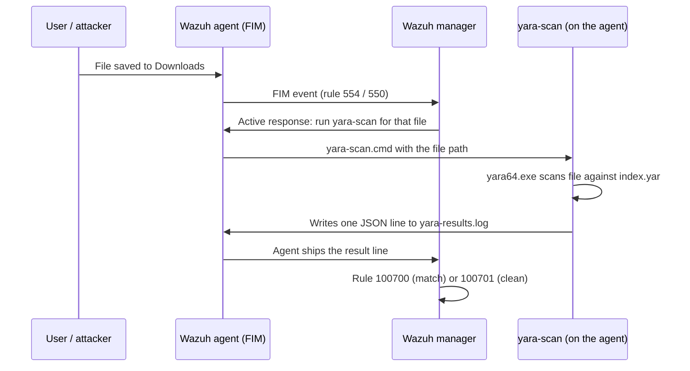

# YARA: Scan-on-Change Malware Detection

> **Order:** [manager side](https://github.com/TanZero7/wazuh-manager-toolkit/tree/main/yara) **first** → then this endpoint folder → then verify ([INTEGRATION-GUIDE.md § 4](INTEGRATION-GUIDE.md)).
> Every check prints `[PASS]`/`[FAIL]`; if something shows `[FAIL]`, wait **5–10 minutes after installation** and run it again before troubleshooting.

Installs the YARA scanning engine and an open-source signature pack on a
Windows endpoint, and wires it to fire automatically, via Wazuh
**active-response**, every time File Integrity Monitoring sees a file
added or changed in a watched directory (Desktop/Downloads by default).
Content-based detection, running alongside the hash-based VirusTotal check on
the same event.

Gives you:

1. **Content-based malware detection**: not just a hash lookup. YARA
   pattern-matches file *content*, catching variants a hash-only check would
   miss.
2. **416 curated open-source rules** from
   [Neo23x0/signature-base](https://github.com/Neo23x0/signature-base)
   (Florian Roth): generic malware, webshells, suspicious patterns.
3. **Automatic, no polling**: driven by Wazuh's FIM realtime events, not a
   scheduled sweep.

Results come back as Wazuh alerts: **rule 100700** = match, **100701** = clean scan.
It only scans and reports; it never deletes or moves files.

## What is YARA?

**YARA** is the pattern-matching tool malware analysts use to describe and find
malware families, often called "grep for malware". A YARA **rule** lists
strings or byte patterns plus a condition, and YARA reports which rules match a
given file. For example:

```yara
rule Suspicious_PowerShell_Download {
    strings:
        $a = "DownloadString" nocase
        $b = "IEX" nocase
    condition:
        $a and $b
}
```

Unlike a hash check (which only recognises the *exact* known file), YARA looks
at **what's inside** the file, so it can catch **new variants** of a known
family, repacked samples, and malicious scripts that have never been seen before.

This kit installs `yara64.exe` with **416 open-source rules** from
[Neo23x0/signature-base](https://github.com/Neo23x0/signature-base), and runs a
scan **automatically on every file FIM sees added or changed**.

### How it works here



No polling and no full-disk sweeps: each changed file is scanned once, seconds
after it appears.

### What you see in Wazuh

| Rule | Level | Meaning | Key fields |
|---|---|---|---|
| **100700** | 12 | YARA rule matched | `data.yara_rule`, `data.yara_scanned_file` (MITRE T1204.002) |
| **100701** | 3 | File scanned, clean | `data.yara_scanned_file` |

Dashboard search: `rule.groups:yara_alert` for matches only.

### Why a SOC cares

- **Catches what hashes miss:** a recompiled or slightly modified sample has a
  brand-new hash but still contains the same code patterns.
- **Explains the detection:** the alert names the exact rule that fired
  (e.g. a webshell or a specific malware family), which speeds triage.
- **Layered with VirusTotal:** VirusTotal answers "is this exact file known
  bad?"; YARA answers "does this file *look like* known bad?". Running both on
  the same FIM event covers each other's blind spots.
- **Proven quietly:** 100701 clean results confirm the pipeline is alive even
  when nothing malicious is around.

---

## Start here

| If you want to... | Read |
|---|---|
| **Deploy step by step** | **[../guides/SYSMON-YARA-SETUP-GUIDE.md § 2](../guides/SYSMON-YARA-SETUP-GUIDE.md#2-yara-endpoint)** |
| Full reference, live test, Windows gotchas, troubleshooting | [INTEGRATION-GUIDE.md](INTEGRATION-GUIDE.md) |

## Folder layout

```
README.md
INTEGRATION-GUIDE.md           full deployment + troubleshooting guide
Run-Setup.cmd                  runs the scripts below in order
Run-Verify.cmd                 health check
scripts/
  install-yara.ps1             installs yara64.exe + the signature-base rule pack
  wire-active-response.ps1     deploys active-response/ into the agent, wires the results log
  verify.ps1                   [PASS]/[FAIL] checks
active-response/
  yara-scan.ps1 + .cmd         what the agent runs on every FIM add/change
```

The manager half (rules 100700/100701, the `ossec.conf` active-response block,
logtest samples) lives in `yara/` of
[wazuh-manager-toolkit](https://github.com/TanZero7/wazuh-manager-toolkit).

## Install (endpoint)

The [manager side](https://github.com/TanZero7/wazuh-manager-toolkit/tree/main/yara) must be done first. Both halves are required:
the endpoint alone does nothing until the manager knows to trigger it.

Elevated Command Prompt:
```bat
cd yara
powershell -ExecutionPolicy Bypass -File .\scripts\install-yara.ps1
powershell -ExecutionPolicy Bypass -File .\scripts\wire-active-response.ps1
```

## Check it's working

1. `scripts\verify.ps1`: every line `[PASS]`, ending in "All static checks passed."
2. Live marker-file test: [INTEGRATION-GUIDE.md § 4.2](INTEGRATION-GUIDE.md#42-live-end-to-end-test-recommended)
   (static checks alone don't prove the active-response chain fires).

## Deploying to another Windows machine

Copy this folder and run the endpoint steps. The manager side is installed
once, centrally, and covers every endpoint.

## Known limitations

- 416 generic rules is a solid baseline layer, not a commercial-grade feed, so
  it will not catch everything. It's designed to sit *behind* VirusTotal, not
  replace it.
- Only scans files under Wazuh's FIM-watched directories (Desktop/Downloads
  by default). It is not a full-disk on-access scanner.
- Read **INTEGRATION-GUIDE.md section 6 (Windows-specific gotchas)** before
  you debug a "nothing happens" symptom. Two real, non-obvious bugs were
  found and fixed building this, and they will bite you again if you write
  your own active-response script from scratch instead of reusing this one.
